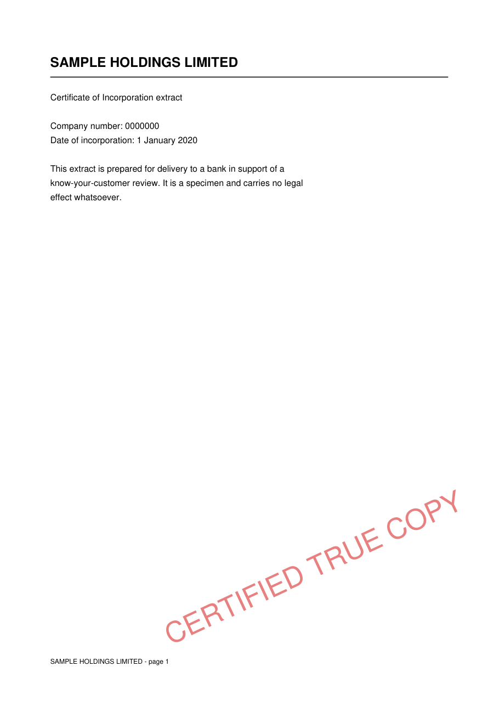

# certified-true-copy

Turn a scanned PDF into a **certified true copy** — the thing you hand to a bank, a registry, or a counterparty when they want "a copy, certified".

Four steps, in this order:

1. **Drop blank pages.** Duplex scanners produce a blank back side for every sheet; a certified bundle should not contain them.
2. **Stamp every page.** A translucent diagonal `CERTIFIED TRUE COPY` stamp. Placement is size-aware: the stamp's real rotated footprint is measured first, then slid over the page to the emptiest spot that touches no word — so it lands in white space instead of across the text.
3. **Certify on the last page.** A block with the heading, date, signature line, and the certifier's name and membership/registration line.
4. **Lock it.** AES-256 with an empty user password (so anyone can open and print) and print-only permissions — no editing, no annotating, no text copying, no page reassembly.



```bash
pip install pymupdf
python -m ctc.cli bundle.pdf --name "A. Person" --membership "Membership No. 0000000"
```

```
written : bundle_certified.pdf
pages   : 17 -> 9
removed : blank page(s) [2, 4, 6, 8, 10, 12, 14, 16]
lock    : print-only (opens without a password)
owner pw: 4sKd...  <- keep this if you ever need to edit
```

## Why this exists

Company secretarial and compliance work runs on paper trails: certified copies of registers, resolutions, identity documents, audited accounts. Doing it by hand means opening a 30-page scan, deleting the blank backs one at a time, stamping, typing the same block, and exporting — for every copy, every time. It is mechanical, it is easy to get subtly wrong, and it is the sort of thing that quietly eats an afternoon.

This is the automated version. It is deliberately small: one file of drawing logic, one CLI, no service, no database, no cloud. The document never leaves the machine it runs on.

## Python API

```python
from ctc import Certifier, certify_pdf

result = certify_pdf(
    "register.pdf",
    "register_certified.pdf",
    certifier=Certifier(
        name="A. Person",
        membership="Membership No. 0000000",
        heading="Certified True Copy",
    ),
    signature="signature.png",
    date="5 Aug 2026",
)
print(result["pages_out"], result["owner_password"])
```

`Certifier` renders only the fields you fill in, so the same class produces both the short form (`Certified True Copy` / `Date:` / signature / name / membership) and the verbose form some institutions demand (institution, capacity, company, address, phone).

| Argument | Default | Notes |
| --- | --- | --- |
| `strip_blanks` | `True` | Remove pages with no text layer and almost no ink |
| `stamp_pages` | `True` | Diagonal stamp on every remaining page |
| `blank_threshold` | `0.01` | Ink fraction below which an image-only page counts as blank |
| `owner_password` | random | Printed once by the CLI; returned by the API |
| `block_pos`, `stamp_pos` | auto | Relative (0-1) centre, detected from empty space |

## Web app

`webapp/` is the version I actually use — same engine, a browser in front of it.

```bash
cd webapp
pip install -r requirements.txt
uvicorn app:app --host 127.0.0.1 --port 8500
```

What it adds over the CLI:

- **Live preview.** Picking a PDF renders page 1 and the last page and proposes a stamp and block position automatically.
- **Move the stamp.** Drag it with a mouse, a finger, or a stylus (pointer events with capture, so it keeps tracking outside the image), or tap anywhere on the page to drop it there. `Chop` / `Block` toggles pick which overlay you are moving.
- **Guidance paste box.** Some institutions send a paragraph of instructions ("certified true copy, date, signature, name, membership number, institution, contact address"). Paste it and the requirements are parsed into the fields the certificate block should carry — instead of guessing.
- **Optional signature image**, drawn above the line.
- **Job log** in SQLite (`webapp/data/`) if you want a record of what you certified and for whom.

Nothing personal is baked into the source. The certifier identity comes from the environment:

| Variable | Meaning |
| --- | --- |
| `CTC_NAME` | name printed under the signature line |
| `CTC_MEMBERSHIP` | membership / registration line |
| `CTC_POSITION`, `CTC_INSTITUTION`, `CTC_ADDRESS`, `CTC_PHONE` | optional block lines |
| `CTC_SIGNATURE` | path to a signature PNG |
| `CTC_DB` | where the job log lives |
| `CTC_JOBS_KEY` | key for the `/jobs` page (otherwise a local `.jobs_key` file) |
| `CTC_DEMO` | `1` = public demo mode: no login, no job log, no stored uploads, identity forced to `DEMO` |

**Privacy by default.** Uploads and outputs live in a temporary directory and are deleted when the response is finished; previews expire. In `CTC_DEMO=1` the job log is never written at all, so a public demo cannot leak someone's document list. A plain clone with no `.ctc_pass` file cannot be logged into — you have to run it in demo mode or set a password deliberately.


## What "locked" does and does not mean

`permissions=PDF_PERM_PRINT` with an owner password means a PDF reader will refuse to edit, annotate, extract text, or reorder pages. It is a speed bump for honest people and a clear signal of intent — **it is not cryptography against a determined party**, because anyone holding the owner password, or a PDF library that ignores permission flags, can still change the file. If you need tamper evidence rather than tamper prevention, hash the output and record the hash somewhere the recipient can check (or put it on a signature/verification service).

## Limitations

- The blank-page test trusts the text layer first and ink coverage second. A scanned page with faint pencil marks but no text layer may be dropped — pass `--keep-blanks` when the source is a low-quality scan.
- No OCR, no redaction, no signature validation. It draws and it locks.
- The signature image is placed above the line at a fixed height; crop your signature to roughly 3:1 rather than relying on the tool to resize it.

## Tests

```bash
PYTHONPATH=. python -m unittest discover -s tests -v
```

The suite builds its own PDFs (text page / blank page / dense page / all-blank), then asserts blank removal, stamp placement per page, block contents, print-only permissions, that the owner password is the only way back to an editable document, and — the placement tests — that the auto-chosen stamp box stays inside the paper and intersects no word box, including on a page with a footer near the bottom edge.

## Licence

MIT — see [LICENSE](LICENSE).
